<div align="center">


# محافظ · Muhafid

**التصنيف المحافظ للمحتوى الإبداعي**<br>
Conservative Classification of Creative Content (CCCC)

[**muhafid.com**](https://muhafid.com) · [دليل التصنيف المحافظ](https://muhafid.com/guide) · [عن المشروع](https://muhafid.com/about) · [English](https://muhafid.com/en)

<p dir="ltr"><a href="#العربية">العربية</a> · <a href="#english">English</a> · <a href="#for-developers">For developers</a></p>

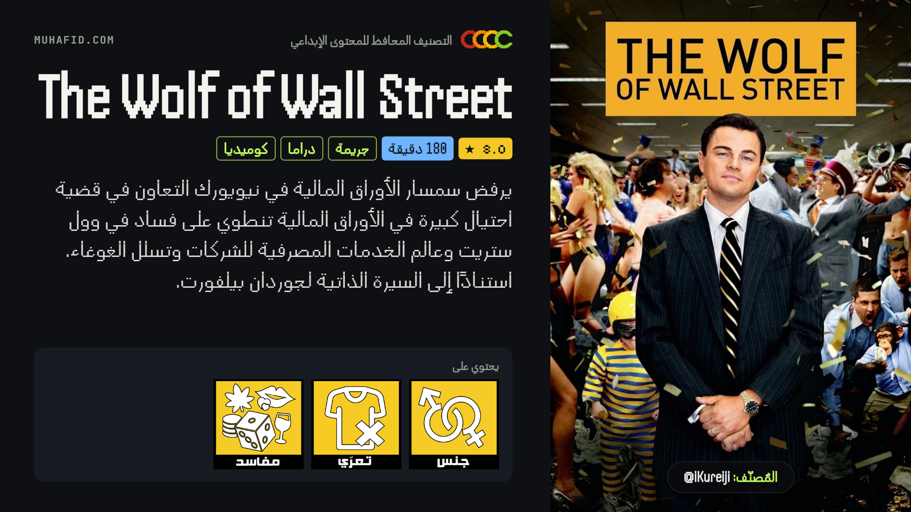

</div>

---

<div dir="rtl">

## العربية

> **باختصار:** محافظ منصة تصنّف فيها الأعمال اللي خلّصتها (لعبة، أنمي، مسلسل، فيلم، مانجا، كتاب) وتقول للناس شنو فيها وبأي درجة، عشان تفيدهم قبل ما يبدأون فيها، من غير حرق. تحدد المحاذير وتطلع لك بطاقة جاهزة تشاركها. التصنيف من المتابع للمتابع، والمشروع مفتوح المصدر ويمديك تساهم فيه.

**محافظ** منصة مجانية مفتوحة المصدر يصنّف فيها المتابع الأعمال الفنية التي أنهاها، فيبيّن ما تحتويه من محاذير ومقدار كلٍّ منها، ليفيد بذلك من يريد مشاهدتها أو لعبها أو قراءتها لاحقًا، وفق معايير محافظة مستمدّة من القيم الإسلامية. تختار العمل الذي أنهيته، وتحدّد ما فيه من محاذير ودرجة كلٍّ منها، فتحصل على بطاقة أنيقة جاهزة للمشاركة.

لا يتطلب الموقع إنشاء حساب ولا تسجيل دخول.

### نبذة عن المشروع

تبيّن التصنيفات العمرية الشائعة، مثل ESRB وPEGI وGCAM، الفئة العمرية التي يناسبها العمل، لكنها لا تفصّل ما يحتويه ولا مقداره. ويهدف محافظ إلى سدّ هذه الفجوة: فمن أنهى عملًا يصف لغيره محتواه ودرجة حضوره وصفًا واضحًا، دون كشف أحداثه.

### مبادئ المشروع

- **تصنيف من المتابع إلى المتابع:** يصنّف العملَ من شاهده أو لعبه أو قرأه، وليس هيئة رسمية.
- **المصداقية للمُصنِّف:** التصنيف رأي صاحبه في العمل، وتقوم الثقة به على سمعته.
- **مفتوح المصدر:** المشروع مفتوح للمجتمع، يراجعه ويطوّره من شاء.

### لمن هذه الأداة؟

- **لكل من أنهى عملًا** ويريد أن يُطلع غيره على ما فيه دون حرق للأحداث.
- **للمراجعين وصنّاع المحتوى** الذين يقدّمون توصياتهم لجمهور محافظ.
- **للأسر والآباء ولكل من يريد قرارًا واعيًا** قبل أن يبدأ عملًا جديدًا أو قبل أن يطّلع عليه أبناؤهم: يطّلعون على البطاقات التي يشاركها المُصنِّفون.

### الأنواع المدعومة

أنمي · مانجا · أفلام · مسلسلات · ألعاب · كتب — إضافةً إلى **الوضع اليدوي** لأي عمل غير موجود في قواعد البيانات، إذ تكتب العنوان والنبذة وترفع الغلاف بنفسك.

### كيف تعمل؟

1. اختر نوع المحتوى، ثم ابحث عن العمل باسمه.
2. يجلب الموقع تلقائيًا الغلاف والنبذة مترجمةً إلى العربية، والتصنيفات، والتقييم، والمدة (عدد الحلقات، أو مدة الفيلم، أو ساعات إنهاء اللعبة، أو عدد الصفحات).
3. أضِف المحاذير الموجودة في العمل، وحدّد درجة كلٍّ منها.
4. أشِر إلى المستثنيات التي يخلو منها العمل.
5. اكتب اسمك وتقييمك بوصفك مُصنِّفًا (اختياري)، ثم صدّر البطاقة صورةً أو انسخها مباشرةً، بالعرض (1920×1080) أو بالطول (1200×1500).

يعمل الموقع على الجوال بتصميم خاص به: تبقى البطاقة ظاهرة أعلى الشاشة أثناء التعديل، ويُشارك التصدير مباشرةً إلى إكس وواتساب وغيرهما.

<div align="center">
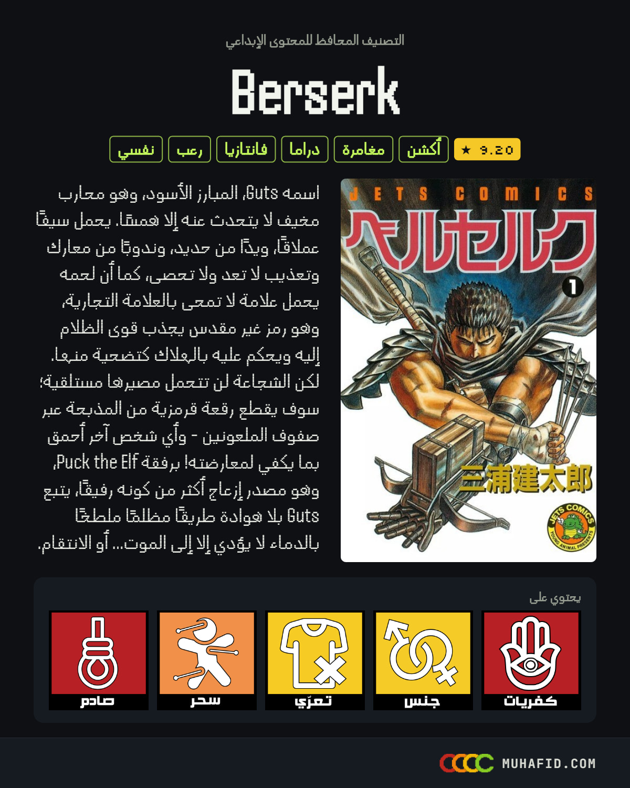 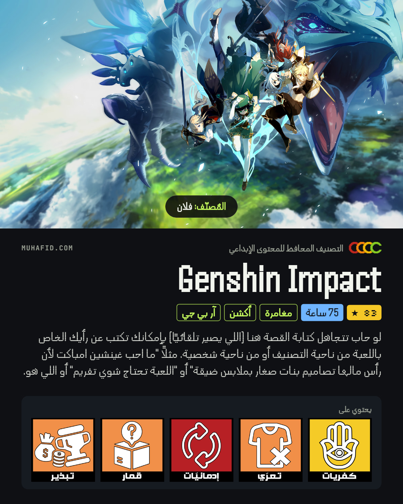
</div>

### نظام التصنيف

يقوم التصنيف على ثلاثة عناصر: درجة الحضور، والموجودات، والمستثنيات.

#### مقياس الحضور

| الدرجة | اللون | في الأعمال القصصية | في الألعاب |
|:---:|:---:|---|---|
| **الأولى · أساسي** | 🟥 أحمر | يتكرر المحتوى ويشكل جزءا أساسيا من القصة، بحيث يصعب فهمها عند تخطيه، أو يلازم العمل طوال عرضه، كشخصية تظهر بملابس كاشفة في معظم المشاهد. | لا يمكن إتمام اللعبة دون المرور بهذا المحتوى. |
| **الثانية · متكرر** | 🟧 برتقالي | يمكن تخطي المحتوى دون التأثير على فهم القصة، لكن تكرار التخطي يقطع تسلسلها. | يمكن إتمام اللعبة مع تجنب هذا المحتوى، لكن تجنبه يزيد صعوبتها ويغير التجربة. |
| **الثالثة · عابر** | 🟨 أصفر | يظهر المحتوى نادرا، ويسهل تخطيه دون التأثير على فهم القصة. | يمكن تجاهل المحتوى أو اتباع طرق بديلة لإتمام اللعبة. |

#### الموجودات: ما قد يحتويه العمل

| المجموعة | المحذور | الأيقونة (أساسي · متكرر · عابر) | الوصف |
|---|---|---|---|
| محاذير عقدية وفكرية | **كفريات** |    | محتوى يسخر من الله أو الأنبياء أو الأديان، أو يدعو إلى الكفر أو الإلحاد أو إلى عقائد تخالف الإسلام، أو (في الألعاب) يجعل اللاعب يتعبّد لغير الله، كالصلاة أو السجود أو تقديم القرابين. |
|  | **سحر** |    | قوى ورموز وتعويذات مرتبطة بالسحر والتنجيم والتنبؤ بالغيب. |
| محاذير أخلاقية ومحتوى صادم | **جنس** |    | مشاهد العلاقة الجنسية، سواء عُرضت صراحة أو أُشير إليها بوضوح، كمشهد ينقطع قبيل العلاقة أو بعدها مباشرة. لا يشمل التقبيل (يُصنَّف في «مفاسد»). |
|  | **تعري** |    | كشف ما يُستر من الجسد، من الملابس الكاشفة كملابس السباحة والملابس الداخلية وإظهار الصدر، إلى التعري الجزئي أو الكامل. وللرجال: كشف ما بين السرة والركبة. |
|  | **شذوذ** |    | عرض أو تمجيد الشذوذ، بما يشمل العلاقات المثلية والتحول الجنسي والموضوعات المرتبطة بهما. |
|  | **صادم** |    | العنف الدموي والأشلاء والتعذيب والانتحار والاغتصاب، والقسوة التي يمارسها اللاعب بنفسه. |
|  | **مفاسد** |    | تناول الخمر أو المخدرات أو ممارسة القمار على الشاشة أو الترويج لها، إضافة إلى الإغراء: التقبيل، والكلام أو الحركات المغرية، واللقطات التي تركّز على مفاتن الجسد. لا يشمل التدخين؛ لشيوعه في أغلب الأعمال. |
| استغلال مالي وسلوكي<br>(خاص بالألعاب) | **إدمانيات** |    | آليات تربط التقدم بالعودة اليومية المنتظمة، مثل تسجيل الدخول اليومي وسلاسل الأيام المتتالية. |
|  | **تبذير** |    | ربط التقدم بالمال المنفق على عناصر داخل اللعبة. |
|  | **قمار** |    | آليات تشجع على شراء صناديق بمحتويات عشوائية أو دفع المال مقابل سحوبات عشوائية. |

#### المستثنيات: ما يخلو منه العمل

يفترض نظام التصنيف وجود الموسيقى أو الأغاني، والألفاظ النابية، والعلاقات العاطفية خارج الزواج في العمل ما لم يشر التصنيف إلى خلاف ذلك. استخدم كل رمز من الرموز التالية فقط إذا كان العمل يخلو من المحتوى الذي يشير إليه.


<div align="center">
  
</div>

للاطلاع على الشرح الكامل، راجع [دليل التصنيف المحافظ](https://muhafid.com/guide).

### الخصوصية

عند تصدير بطاقة أو نسخها، يحفظ الموقع: العمل الذي صنّفته، والدرجات والشارات التي اخترتها، واسم المُصنِّف وتقييمه من 10 إن كتبهما، والنبذة إن كتبتها بنفسك أو عدّلتها، ولغة الموقع، وإصدار الدليل، وقيمةً مُجزّأة بمفتاح سري (HMAC-SHA256) لعنوان IP بدلًا من العنوان نفسه؛ وذلك لاحتساب تصنيف واحد لكل شخص في كل عمل.

لا يطلب الموقع بريدًا إلكترونيًّا ولا يستخدم كوكيز. يعدّ الزيارات بشكل مجهول عبر GoatCounter (بلا كوكيز ولا بيانات شخصية)، ويُحمّل بعض الخطوط من Google Fonts ومكتبة html2canvas من cdnjs.

### مصادر البيانات

يعتمد محافظ على هذه الخدمات لجلب معلومات الأعمال، دون أن تربطه بأيٍّ منها علاقة رسمية:

- **الأنمي والمانجا:** [AniList](https://anilist.co)، ثم [Kitsu](https://kitsu.io) بديلًا احتياطيًّا
- **الأفلام والمسلسلات:** [TMDB](https://www.themoviedb.org) — يستخدم الموقع بيانات TMDB، دون أن يكون معتمدًا منها.
- **الألعاب:** [RAWG](https://rawg.io) للمعلومات، و[SteamGridDB](https://www.steamgriddb.com) للأغلفة، و[HowLongToBeat](https://howlongtobeat.com) لساعات إنهاء القصة الرئيسية
- **الكتب:** [Open Library](https://openlibrary.org)
- **الترجمة إلى العربية:** Google Translate، و[MyMemory](https://mymemory.translated.net) بديلًا احتياطيًّا

### حالة المشروع والمساهمة

الأداة في مرحلة تجريبية (ألفا/بيتا)، وهي قابلة للاستخدام من الآن. والمساهمات مرحّب بها:

- أبلغ عن خطأ، أو تصنيف ناقص، أو فكرة: افتح [Issue](https://github.com/Avuduru/cccc/issues) جديدًا.
- عدّل المشروع مباشرةً عبر طلب دمج (Pull Request): راجع [قسم المطوّرين](#for-developers).

### الترخيص

المشروع مرخّص بموجب [رخصة MIT](LICENSE).

### المساهمون والشكر

- **هادي** ([Hadi Alahmad](https://github.com/hadealahmad) · [hadealahmad.com](https://hadealahmad.com)) — أسهم في تصميم الموقع وتطويره.
- **Claude** (من Anthropic) — مساعدة في التطوير.
- **Cyro** — مساعدة في بعض المسمّيات.

يطوّر المشروع ويديره **كوريجي** ([@Avuduru](https://github.com/Avuduru) · [@iKureiji](https://twitter.com/iKureiji)).

</div>

---

## English

> **In short:** Muhafid is a platform where you rate works you have already finished — games, anime, series, movies, manga, books — and tell others what they contain and how present it is, so they can decide before starting, without spoilers. You mark the warnings and get a card to share. Ratings come from consumers, not an authority, and the project is open source.

**Muhafid** is a free, open-source platform where you rate a movie, series, anime, game, manga, or book *after you have finished it*, recording what it contains and how present each element is, so that others can decide before they watch, play, or read it — based on conservative Islamic values. Pick the work, mark what it contains and how present it is, and get a clean card you can share.

No account or sign-up needed.

### About the project

Common age ratings such as ESRB, PEGI, and GCAM tell you which age group a work suits, but not what it contains or how much. Muhafid fills that gap: whoever has finished a work describes its content and how prominent it is, clearly and without spoilers.

### Principles

- **Consumer to consumer:** a work is rated by someone who watched, played, or read it, not by an official body.
- **Credibility belongs to the classifier:** a rating is its author's opinion of the work, and trust in it rests on their reputation.
- **Open source:** the project is open to the community to review and improve.

### Who is it for?

- **Anyone who has finished a work** and wants to tell others what is in it, without spoilers.
- **Reviewers and creators** who recommend content to a conservative audience.
- **Families, parents, and anyone deciding what to start next**, who read the cards classifiers share — for example before their kids see a work.

### What can you rate?

Anime · Manga · Movies · TV series · Games · Books — plus **manual mode** for anything not in the databases (you type the title and upload the cover yourself).

### How it works

1. Pick a content type and search for the title.
2. The site fills in the cover, the synopsis, genres, score, and length (episodes, runtime, hours to beat, or pages). The Arabic site translates the synopsis and genres; the English site keeps them as the sources write them.
3. Add the warnings that apply and set how present each one is.
4. Mark what the work is *free of*.
5. Add your name and score as the classifier (optional), then export the card as an image or copy it — wide (1920×1080) or tall (1200×1500).

On phones the site has its own layout: the card stays pinned at the top while you edit, and Export opens the share sheet for X, WhatsApp and others.

<div align="center">
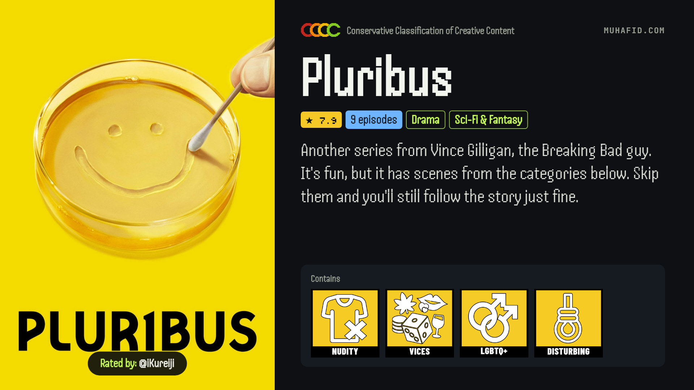
</div>

### The rating system

**Levels**

| Level | Color | In story-based media | In games |
|:---:|:---:|---|---|
| **1 · Core** | 🟥 Red | The content is central and appears frequently, so skipping it makes the story hard to follow; or it is present throughout, such as a character shown in revealing clothes in most scenes. | You cannot finish the game without encountering this content. |
| **2 · Recurring** | 🟧 Orange | You can skip the content and still follow the story, but frequent skipping disrupts the experience. | You can finish the game while avoiding this content, but doing so makes it harder and changes the experience. |
| **3 · Passing** | 🟨 Yellow | The content is rare and easy to skip without losing track of the story. | You can ignore the content or take another route to finish the game. |

**Warnings (what a work may contain)**

| Group | Warning | Icon (core · recurring · passing) | Meaning |
|---|---|---|---|
| Belief and ideology | **Blasphemy** (كفريات) |   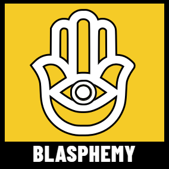 | Content that mocks God, the prophets or religion; advocates disbelief, atheism or beliefs that conflict with Islam; or (in games) has the player worship anything other than God, such as praying, bowing or making offerings. |
|  | **Magic** (سحر) | 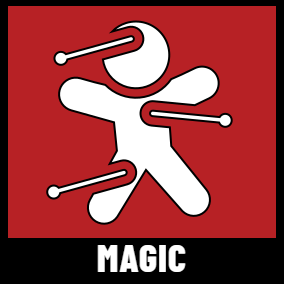 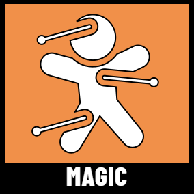 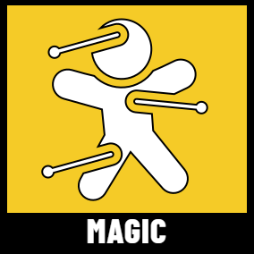 | Powers, symbols and spells tied to sorcery, astrology and fortune-telling. |
| Moral and disturbing content | **Sexual content** (جنس) |    | Sexual acts, shown or clearly implied, such as a scene that cuts away just before or after. Kissing is not included (it counts under Vices). |
|  | **Nudity** (تعري) | 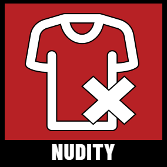 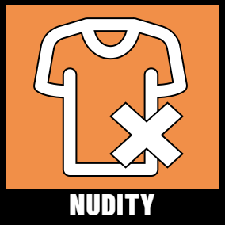 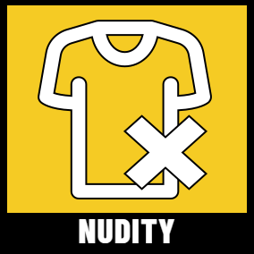 | Showing parts of the body that are normally covered: from revealing clothes such as swimwear, underwear or visible cleavage, to partial or full nudity. For men: anything between the navel and the knee. |
|  | **LGBTQ+ themes** (شذوذ) |    | Depictions or positive portrayals of LGBTQ+ themes, including same-sex relationships and transgender identities. |
|  | **Disturbing** (صادم) |  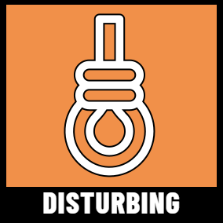  | Graphic violence, gore, torture, suicide and rape, and cruelty the player carries out themselves. |
|  | **Vices** (مفاسد) | 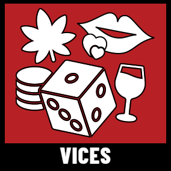 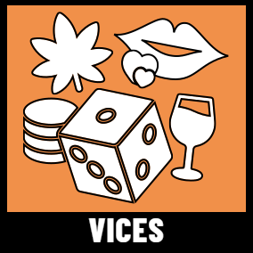 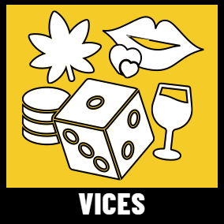 | Drinking, drug use or gambling on screen, or promoting them, plus seduction: kissing, seductive talk or gestures, and shots that dwell on the body. Smoking is not included, as it appears in most works. |
| Spending and engagement<br>(games only) | **Addictive design** (إدمانيات) | 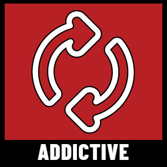 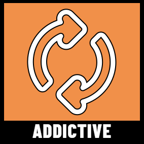 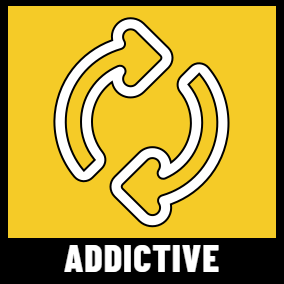 | Mechanics that require regular daily returns to keep progressing, such as daily logins and streaks. |
|  | **Pay-to-win** (تبذير) |    | Progress is tied to money spent on in-game items. |
|  | **Gambling** (قمار) |    | Mechanics that encourage spending on loot boxes or gacha pulls with random rewards. |

**"Free of" badges**

For rating purposes, CCCC assumes a work contains music or songs, profanity, and romantic relationships outside marriage unless marked otherwise. Use each badge below only when the work is free of that content. The badges: **No music**, **No profanity**, **No dating/affairs**.

<div align="center">
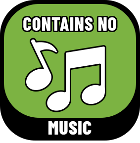 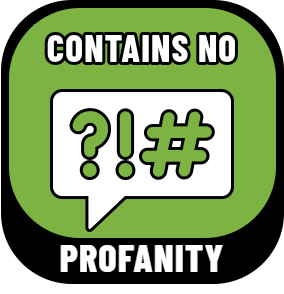 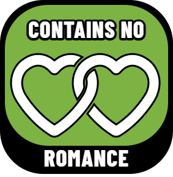
</div>

Full details: [rating guide](https://muhafid.com/en/guide). The whole site is available in English at [muhafid.com/en](https://muhafid.com/en): the tool, the guide and the about page, laid out left to right, with English cards and icons.

### Privacy

When you export or copy a card, the site saves the work, the ratings and badges you picked, your classifier name and /10 score if you entered them, the synopsis if you wrote or edited it yourself, the site language, the guide version, and a keyed hash (HMAC-SHA256) of your IP address — never the IP itself, and not reversible without the server's secret key — so each person counts once per work.

No email, no cookies. Visits are counted anonymously with GoatCounter (no cookies, no personal data). Some fonts load from Google Fonts and html2canvas from cdnjs.

### Data sources

Muhafid uses these services and is not affiliated with any of them:

- **Anime & manga:** [AniList](https://anilist.co), with [Kitsu](https://kitsu.io) as the backup
- **Movies & TV:** [TMDB](https://www.themoviedb.org) — This product uses the TMDB API but is not endorsed or certified by TMDB.
- **Games:** [RAWG](https://rawg.io) for game info, [SteamGridDB](https://www.steamgriddb.com) for covers, [HowLongToBeat](https://howlongtobeat.com) for main-story hours
- **Books:** [Open Library](https://openlibrary.org)
- **Translation to Arabic:** Google Translate, with [MyMemory](https://mymemory.translated.net) as a backup

### Status and contributing

The tool is in alpha/beta and usable today. Contributions are welcome:

- Found a bug, a missing category, or an idea? [Open an issue](https://github.com/Avuduru/cccc/issues).
- Change the project directly with a pull request: see [For developers](#for-developers).

### License

Released under the [MIT License](LICENSE).

### Contributors and acknowledgements

- **Hadi** ([Hadi Alahmad](https://github.com/hadealahmad) · [hadealahmad.com](https://hadealahmad.com)) — contributed to the site's design and development.
- **Claude** (by Anthropic) — development assistance.
- **Cyro** — help with some of the naming.

Developed and maintained by **Kureiji** ([@Avuduru](https://github.com/Avuduru) · [@iKureiji](https://twitter.com/iKureiji)).

---

## For developers

### Stack

- **Backend:** PHP 8.4, no framework and no Composer packages. `proxy.php` calls the external APIs (so keys stay on the server) and stores classifications.
- **Frontend:** plain HTML, CSS, and JavaScript modules. The card is laid out at its real export size (1920×1080 or 1200×1500) and the preview is the same element scaled down, so the preview and the export match. Exports are drawn with [html2canvas](https://html2canvas.hertzen.com) and saved as full-colour JPEG (quality 92, no chroma subsampling) with the vendored [jSquash](https://github.com/jamsinclair/jSquash) MozJPEG encoder; Copy puts a PNG on the clipboard.
- **Database:** MySQL or MariaDB (optional — without it, classifications go to `data/classifications.jsonl`).
- **Hosting:** [CranL](https://cranl.com) with Railpack (FrankenPHP/Caddy). Every push to `main` deploys.

### Project layout

| Path | What it does |
|---|---|
| `index.html` | The app |
| `guide.html` | The rating guide (`/guide`) |
| `about.html` | About the project (`/about`), ending with the dated **changelog** of rating-guide changes (`/about#changelog`) |
| `local-router.php` | Clean URLs for the PHP dev server (`php -S … local-router.php`); production uses `index.php` + the `Caddyfile` |
| `index.php` | Clean URLs (`/guide` → `guide.html`, `/en/guide` → `lang/en/guide.html`); adds `?v=<file time>` to every local CSS/JS/image link and an import map for the JS modules, so each deploy only refreshes the files that changed. The finished page is built once per deploy and kept in the system temp dir (`cccc-pages/`, 10-min safety TTL; skipped on the PHP dev server) |
| `lang/en/` | The English pages (`/en`, `/en/guide`, `/en/about`), generated from the Arabic ones — don't edit them by hand (see below) |
| `ltr.css` | Mirrors the layout left-to-right for the English pages (loaded only there) |
| `proxy.php` | API proxy, HowLongToBeat lookup, translation, image proxy, classification storage and stats |
| `js/` | Frontend modules: `app.js` (entry point), `card.js` (renders the card and fits every text block by measuring it), `export.js` (Export / Copy), `phone.js` (phone layout), `i18n.js` (every string the scripts show, in Arabic and English), `ui.js`, `api.js`… |
| `js/vendor/jsquash-jpeg/` | MozJPEG encoder (WebAssembly), loaded on the first export |
| `style.v3.css` · `card.css` · `phone.css` | Site styles · the card · the phone layout (≤ 640px) |
| `assets/icons/` | Warning and badge icons; `assets/icons/en/` holds the English versions |
| `assets/fonts/` | Handjet (served from the site; Google's copy broke Arabic letter joins on iOS) and PixelAE |
| `tools/en-icons/` | Script that rebuilds the English icons from the Arabic ones (edit the labels, re-run) |
| `tools/i18n/build_en.py` | Builds `lang/en/*.html` from the Arabic pages and holds their English wording |
| `tools/i18n/seo.py` | Titles, descriptions, canonical/`hreflang` links, Open Graph / X cards and JSON-LD for every page in both languages |
| `tools/guide_check.py` · `tools/guide_lock.json` | Guide integrity check and its lock (see "Changing the rating guide") |
| `tools/upstream_check.py` · `.github/workflows/upstream-check.yml` | Health check of every outside service (AniList, Kitsu, TMDB, RAWG, Open Library, HLTB, translate, image proxy), direct and through the site; runs every 6 h on GitHub and emails on failure. Run it by hand before blaming the site: `python tools/upstream_check.py` |
| `.github/workflows/guide-check.yml` | Runs the guide check and the English-sync check on every PR and push to `main` |
| `SECURITY.md` | Security model, what's enforced where, and owner-side checklist |
| `tools/og/make_og.py` · `assets/og/` | Renders the link-preview images (1200×630, Arabic and English) |
| `robots.txt` · `sitemap.xml` | Search engines: everything but `proxy.php` may be crawled; the sitemap lists all six pages with their other-language versions |
| `data/schema.sql` | Database schema |
| `Caddyfile` | Web server config: blocks `.git`, dotfiles, `data/`, `tools/`, `lang/` and config files; redirects `www` to the bare domain; long cache for `?v=` files, revalidation for pages |
| `railpack.json` | Pins the PHP version for deployment |

### Run it locally

You need PHP 8.4+ with the `curl` and `openssl` extensions (`pdo_mysql` only if you use a database).

```bash
cp .env.example .env          # then add your API keys and set APP_ENV=local
php -S localhost:8080 local-router.php   # local-router.php serves the clean URLs (/guide, /about, /en/…)
```

On **Windows**, also `cp php.ini.example php.ini` (fix `extension_dir` if needed) and add `-c php.ini` to the `php` command.

Open http://localhost:8080.

> **Windows:** PHP for Windows has no CA certificate bundle, so with `APP_ENV=production` every API call fails with `SSL certificate problem`. `APP_ENV=local` skips the certificate check — never use it in production.

### Contributing with the GitHub CLI

The project is open to contributions. With the [GitHub CLI](https://cli.github.com) (`gh`), the whole flow takes a few commands:

```bash
gh repo fork Avuduru/cccc --clone    # fork the repo and clone your copy
cd cccc
git switch -c my-change              # work on a branch
# edit, then test locally (see "Run it locally")
git commit -am "Describe the change"
gh pr create --fill                  # open a pull request to Avuduru/cccc
```

To report a bug or suggest a change without code: `gh issue create --repo Avuduru/cccc`. Please say what you changed and why.

### Environment variables

| Variable | Needed for | Where to get it |
|---|---|---|
| `TMDB_KEY` | Movies & TV | [themoviedb.org](https://www.themoviedb.org) → Settings → API → API Key (v3 auth) |
| `RAWG_KEY` | Games | [rawg.io/apidocs](https://rawg.io/apidocs) |
| `STEAMGRIDDB_KEY` | Game covers | [steamgriddb.com](https://www.steamgriddb.com) → Preferences → API |
| `APP_ENV` | `local` on your machine, `production` on the server | — |
| `DB_HOST`, `DB_NAME`, `DB_USER`, `DB_PASS` | Saving classifications to MySQL (`DB_HOST` can include `:port`) | Your database |
| `DB_TLS` | *(optional)* encrypt the DB connection: `prefer` (default; plain if TLS fails, logged), `require` (TLS or no connection), `off`. The server certificate isn't verified (CranL's is self-signed and regenerated) | You |
| `IP_HASH_SECRET` | Keys the stored visitor-IP hash so a leaked database can't be reversed into IPs. Generate once with `openssl rand -hex 32`; don't change it casually | You |
| `TRUSTED_IP_HEADER` | *(optional)* the header your host's edge sets to the real client IP, e.g. `X-Real-IP` — used for vote dedup and rate limiting. Unset = last `X-Forwarded-For` entry | Ask your host |

Anime, manga, books, HowLongToBeat, and translation need no keys. On the server, set these in the hosting dashboard instead of a `.env` file.

### Database

Run `data/schema.sql` once (phpMyAdmin, HeidiSQL, or the `mysql` CLI). It creates two tables: `works` (one row per title) and `classifications` (one row per person per title).

Each classification stores the 10 content levels, the 3 exception badges, the classifier's name, the classifier's own **/10 score** (`classifier_rating`), the **site language** it came from (`lang`, `ar`/`en`), orientation and action. It also stores the classifier's **own synopsis** (`synopsis`) together with a `custom_synopsis` flag — but **only when they wrote it** (manual mode, or they edited the auto-fetched one), so the sources' own text isn't duplicated. Each rating also records the **rating-guide version** it was made under (`guide_version`), set by the server from `GUIDE_VERSION` in `proxy.php`, never from the request. The `stats` endpoint exposes aggregates including `avg_score`, `by_lang`, `custom_synopses`, the current `guide_version` and `by_guide_version`. On an existing database that predates any of these columns, `proxy.php` **adds them automatically** on the first rating save (needs `ALTER` privilege on the DB user); if it can't, saves still work without those fields and you can run the `ALTER TABLE` from `data/schema.sql`'s comment manually. When `guide_version` is added, ratings saved before it existed are set to `1` (they were all made under the launch guide).

### Changing the rating guide (changelog)

Ratings are live, so a change to what a category or level **means** must be traceable. Every such change, in the same PR:

1. Edit the guide (`guide.html`) and anything else the change touches.
2. Raise `GUIDE_VERSION` in `proxy.php` by one, and update the `GUIDE.v<N>` labels in `guide.html` (the footer label links to the changelog).
3. Add a dated entry at the top of the **Changelog** list at the end of `about.html` (`<section id="changelog">`): the new `GUIDE.v<N>`, the date, and one line per change, each tagged with what it touches (`g-levels`, `g-belief`, `g-moral`, `g-games`, `g-exc` — the guide's colours).
4. Add the English for every new Arabic string in `tools/i18n/build_en.py` (`about_rules()` / `guide_rules()`), then run `python tools/i18n/build_en.py`.
5. Lock the new version: `python tools/guide_check.py --lock`, then `python tools/guide_check.py`.
6. After merge, publish a GitHub Release tagged `guide-v<N>` with the changelog text.

**This is enforced.** `tools/guide_check.py` fingerprints the guide text (levels, content flags, exceptions) and stores it in `tools/guide_lock.json`. The **Guide integrity** GitHub Action runs it on every PR and push to `main`: it fails if the guide text changed without a lock, if `GUIDE_VERSION` and the locked version differ, if any `GUIDE.v<N>` label is stale, if the changelog is missing a version, or if the home page's guide modal disagrees with `guide.html`. It also checks that the English pages are in sync.

**Versions:** a **whole number** (`v2` → `v3`) means the meaning changed; it's stored with every rating (`guide_version`) and gets a full changelog entry and a release. A **decimal** (`v2.1`, `v2.2`) means wording only: run `python tools/guide_check.py --lock --wording-only "fix a typo in Magic"`, set the `GUIDE.v` labels in `guide.html` to the new decimal, and add a short `class="cl-minor"` entry at the top of the changelog. Ratings keep storing the whole number, since what they mean didn't change. The next whole version resets the decimal.

The stored `synopsis` is **user-generated text**: it's kept as plain text (control chars stripped, capped) and is never rendered server-side. Anything that later displays it must HTML-escape it and have a way to hide abuse — see `SECURITY.md`.

### Good to know

- **`.htaccess` is not used in production.** The server is Caddy, so access rules and redirects live in the `Caddyfile`.
- **HowLongToBeat has no official API.** `proxy.php` reads the current search endpoint from HowLongToBeat's own website code and caches it for 24 hours, so it keeps working when they move it. If they change the request format itself, `searchHltb()` needs an update.
- **Caching:** only versioned **static files** (`*.css`, `*.js`, images, fonts, `*.wasm`, `*.json` with `?v=`) are cached for a year; the `?v=` list of extensions is in the `Caddyfile`. Pages and `proxy.php` are never long-cached (a `?v=` on them would otherwise let the edge cache a dynamic response under an attacker-chosen URL). Pages send `no-cache`, `proxy.php` sends `no-store`.
- **Translate:** the frontend sends the synopsis to `proxy.php?type=translate` **base64url-encoded** in `q=` (only `A–Z a–z 0–9 _ -`), so a synopsis with a `%`, quote or `<` can't trip the edge WAF's URL-encoding / XSS / SQLi rules. `proxy.php` decodes `q`; plain `?query=` still works as a fallback. See `SECURITY.md`.
- **Security:** see **[`SECURITY.md`](SECURITY.md)** for the full model. In short: `proxy.php?type=image_proxy` only fetches from the image hosts in `$allowedImageHosts` (TMDB, RAWG, SteamGridDB, AniList, Kitsu, MyAnimeList, Open Library, Google Books; archive.org only as Open Library's own redirect), re-checks every redirect, and only passes on real images. **If you add a data source, add its image host there**, or its covers won't load. Detail endpoints accept only plain ids/slugs, no response can contain an API key (output filter), and pages are served with a Content-Security-Policy (`index.php`): new external scripts, fonts or fetch targets must be added to it. Per-visitor rate limits (`rateLimited()` in `proxy.php`, counters in `data/ratelimit/`): 240 API calls and 100 images per 10 minutes (TMDB images only in sizes w92–w1280, 5 MB max), 30 rated works per 10 minutes, and calls that reach RAWG (its free plan is 20,000 a month): 30 per 10 minutes and 100 a day. **Caching** (temp dir, `cacheGet/cachePut` in `proxy.php`): searches 10 min, game searches 24 h (10 min if the number-swapped second search was needed but failed), game details 7 days, the chosen SteamGridDB cover 7 days; game results are slimmed to the fields the site uses (~2 KB instead of ~32 KB); max 3,000 files per bucket. Bump `CACHE_VERSION` when filtering, sorting or slimming changes. Data sources are credited on the About page; RAWG also under the search box on the Games tab (its free plan requires a link). In production the site is also behind the host's edge WAF (OWASP Core Rule Set, in Block mode).
- **Search and link previews:** each page's `<head>` has a block between `<!-- SEO -->` and `<!-- /SEO -->`. Edit the wording in `tools/i18n/seo.py`, run it (it rewrites the Arabic pages), then run `tools/i18n/build_en.py` for the English ones. Keep descriptions under ~155 characters so Google shows them whole. Add new pages to `sitemap.xml`.
- **English site:** the Arabic pages are the source. After changing `index.html`, `guide.html` or `about.html`, run `python tools/i18n/build_en.py`: it rebuilds `lang/en/` and stops with the exact text it couldn't translate if the Arabic changed (add the English wording to the script, then run it again). `--check` only reports whether `lang/en/` is up to date. Text the scripts show (buttons, card placeholders, length pills) lives in `js/i18n.js`. On `/en` the genres and synopsis come straight from the sources, untranslated.
- **English icons:** `python tools/en-icons/make_icons.py` (needs Playwright) repaints the label areas of the Arabic icons and writes `assets/icons/en/`. Change a word in `LABELS` and re-run.
- **Saved IDs are namespaced:** anime/manga use `anilist:<id>` or `mal:<id>`, books use the Open Library key (`/works/OL…W`), games use the RAWG slug, movies/TV use the TMDB ID, and manual entries use `manual:<title>`.
