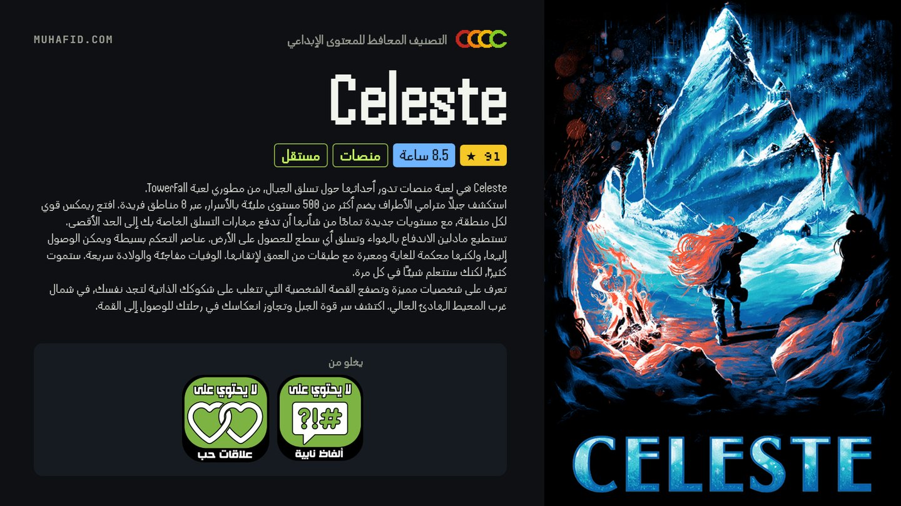
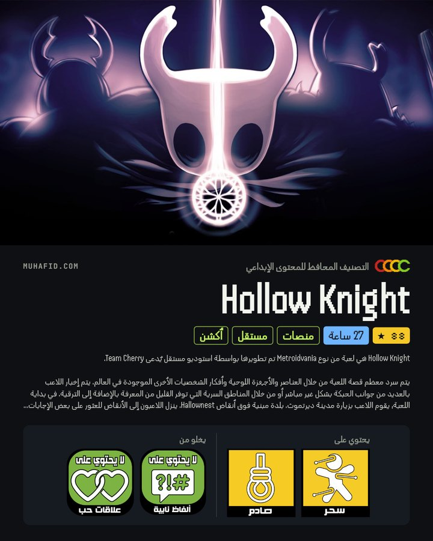

<div align="center">


# محافظ · Muhafid

**التصنيف المحافظ للمحتوى الإبداعي**<br>
Conservative Classification of Creative Content (CCCC)

[**muhafid.com**](https://muhafid.com) · [دليل التصنيف](https://muhafid.com/guide)

<p dir="ltr"><a href="#العربية">العربية</a> · <a href="#english">English</a> · <a href="#for-developers">For developers</a></p>



</div>

---

<div dir="rtl">

## العربية

> **باختصار:** محافظ منصة تصنّف فيها الأعمال اللي خلّصتها (لعبة، أنمي، مسلسل، فيلم، مانجا، كتاب) وتقول للناس شنو فيها وبأي درجة، عشان تفيدهم قبل ما يبدأون فيها، من غير حرق. تحدد المحاذير وتطلع لك بطاقة جاهزة تشاركها. التصنيف من المتابع للمتابع، والمشروع مفتوح المصدر ويمديك تساهم فيه.

**محافظ** منصة مجانية مفتوحة المصدر يصنّف فيها المستهلك الأعمال الفنية التي أنهاها، فيبيّن ما تحتويه من محاذير ومقدار كلٍّ منها، ليفيد بذلك من يريد مشاهدتها أو لعبها أو قراءتها لاحقًا، وفق معايير محافظة مستمدّة من القيم الإسلامية. تختار العمل الذي أنهيته، وتحدّد ما فيه من محاذير ودرجة كلٍّ منها، فتحصل على بطاقة أنيقة جاهزة للمشاركة.

لا يتطلب الموقع إنشاء حساب ولا تسجيل دخول.

### نبذة عن المشروع

تبيّن التصنيفات العمرية الشائعة، مثل ESRB وPEGI وGCAM، الفئة العمرية التي يناسبها العمل، لكنها لا تفصّل ما يحتويه ولا مقداره. ويهدف محافظ إلى سدّ هذه الفجوة: فمن أنهى عملًا يصف لغيره محتواه ودرجة حضوره وصفًا واضحًا، دون كشف أحداثه.

### مبادئ المشروع

- **تصنيف من المستهلك إلى المستهلك:** يصنّف العملَ من شاهده أو لعبه أو قرأه، وليس هيئة رسمية.
- **المصداقية للمُصنِّف:** التصنيف رأي صاحبه في العمل، وتقوم الثقة به على سمعته.
- **مفتوح المصدر:** المشروع مفتوح للمجتمع، يراجعه ويطوّره من شاء.

### لمن هذه الأداة؟

- **لكل من أنهى عملًا** ويريد أن يُطلع غيره على ما فيه دون حرق للأحداث.
- **للمراجعين وصنّاع المحتوى** الذين يقدّمون توصياتهم لجمهور محافظ.
- **للأسر والآباء ولكل من يريد قرارًا واعيًا** قبل أن يبدأ عملًا جديدًا أو قبل أن يطّلع عليه أبناؤهم: يطّلعون على البطاقات التي يشاركها المُصنِّفون.

### الأنواع المدعومة

أنمي · مانجا · أفلام · مسلسلات · ألعاب · كتب — إضافةً إلى **الوضع اليدوي** لأي عمل غير موجود في قواعد البيانات، إذ تكتب العنوان والنبذة وترفع الغلاف بنفسك.

### كيف تعمل؟

1. اختر نوع المحتوى، ثم ابحث عن العمل باسمه.
2. يجلب الموقع تلقائيًا الغلاف والنبذة مترجمةً إلى العربية، والتصنيفات، والتقييم، والمدة (عدد الحلقات، أو مدة الفيلم، أو ساعات إنهاء اللعبة، أو عدد الصفحات).
3. أضِف المحاذير الموجودة في العمل، وحدّد درجة كلٍّ منها.
4. أشِر إلى المستثنيات التي يخلو منها العمل.
5. اكتب اسمك بوصفك مُصنِّفًا (اختياري)، ثم صدّر البطاقة صورةً أو انسخها مباشرةً، بالعرض أو بالطول.

<div align="center">

</div>

### نظام التصنيف

يقوم التصنيف على ثلاثة عناصر: درجة الشدّة، والموجودات، والمستثنيات.

### سُلَّم الشدّة

| الدرجة | اللون | في القصصيّات | في الألعاب |
|:---:|:---:|---|---|
| **الأولى · شديد** | 🟥 أحمر | لا يمكن تخطّي المحتوى دون التأثير على القصة، ويتكرر ظهوره كثيرًا حتى يفقد المشاهد الفهم العام للقصة عند تخطّيه. | يستحيل إتمام اللعبة دون المرور عليه. |
| **الثانية · متوسط** | 🟧 برتقالي | يمكن تخطّي المحتوى دون التأثير على فهم القصة، إلا أن كثرة ظهوره تُقطّع تسلسل العرض. | يُصعّب إتمام اللعبة ويغيّر تجربتها، لكن يمكن إتمامها كاملةً مع تخطّيه. |
| **الثالثة · خفيف** | 🟨 أصفر | يمكن تخطّي المحتوى دون التأثير على القصة، وظهوره قليل يسهل تخطّيه. | يمكن تجاهله أو استخدام طرق بديلة لإتمام اللعبة. |

### الموجودات: ما قد يحتويه العمل

| المجموعة | المحذور | الأيقونة (شديد · متوسط · خفيف) | الوصف |
|---|---|---|---|
| محاذير عقدية وفكرية | **كفريات** |    | ما يروّج للكفر والإلحاد ويسخر من الأديان والذات الإلهية، بما في ذلك تقديم الفلسفات والعقائد المنحرفة بصورة إيجابية أو محايدة. |
| | **سحر** |    | القوى والرموز والتعويذات المرتبطة بالسحر والتنجيم ورؤية المستقبل. |
| انحرافات أخلاقية وصادمة | **جنس** |    | مشاهد جنسية إيحائية أو مباشرة. |
| | **تعرّي** |    | ظهور أشخاص بجسد عارٍ كليًّا أو جزئيًّا. |
| | **شذوذ** |    | عرض الشذوذ الجنسي أو تمجيده بأشكاله المختلفة، كالمثلية والتحوّل الجنسي. |
| | **صادم** |    | محتوى يُلحق أثرًا نفسيًّا بالمشاهد، من عنف دموي وأشلاء واغتصاب وانتحار وتعذيب وما يثير الاشمئزاز الشديد. |
| | **مفاسد** |    | الترويج للقمار أو تعاطي المخدرات أو إظهارهما بصورة إيجابية، فضلًا عن المشاهد المثيرة للغرائز كالإيحاءات الجسدية والإغراء غير الصريح. |
| استغلال مالي وسلوكي<br>(خاص بالألعاب) | **إدمانيّات** |    | تصميم يدفع اللاعب إلى العودة المستمرة والمتابعة اليومية لتحقيق التقدم. |
| | **تبذير** |    | تصميم يربط التقدم بالمال المُنفَق على أغراض داخل اللعبة. |
| | **قمار** |    | تصميم يشجّع على شراء الصناديق ذات المحتوى العشوائي وأنظمة السحب. |

### المستثنيات: ما يخلو منه العمل

يفترض التصنيف المحافظ أن جميع الأعمال الإبداعية تحتوي على الموسيقى والأغاني، والألفاظ النابية، والعلاقات خارج إطار الزواج. فإن خلا العمل من شيء منها، أشار المُصنِّف إلى ذلك بإحدى الشارات الخضراء الآتية:


<div align="center">
  
</div>

للاطلاع على الشرح الكامل، راجع [دليل الدرجات والتصانيف](https://muhafid.com/guide).

### الخصوصية

عند تصدير بطاقة أو نسخها، يحفظ الموقع: العمل الذي صنّفته، والدرجات والشارات التي اخترتها، واسم المُصنِّف إن كتبته، وقيمةً مُجزّأة (SHA-256 hash) لعنوان IP بدلًا من العنوان نفسه؛ وذلك لاحتساب تصنيف واحد لكل شخص في كل عمل.

لا يطلب الموقع بريدًا إلكترونيًّا ولا يستخدم أدوات تحليل أو تتبّع. ويُحمّل الخطوط والمكتبات البرمجية من Google Fonts وcdnjs وjsDelivr.

### مصادر البيانات

يعتمد محافظ على هذه الخدمات لجلب معلومات الأعمال، دون أن تربطه بأيٍّ منها علاقة رسمية:

- **الأنمي والمانجا:** [AniList](https://anilist.co)، و[Jikan](https://jikan.moe) (MyAnimeList) بديلًا احتياطيًّا
- **الأفلام والمسلسلات:** [TMDB](https://www.themoviedb.org) — يستخدم هذا الموقع واجهة TMDB البرمجية، لكنه غير معتمد أو مُصادَق عليه من TMDB.
- **الألعاب:** [RAWG](https://rawg.io) للمعلومات، و[SteamGridDB](https://www.steamgriddb.com) للأغلفة، و[HowLongToBeat](https://howlongtobeat.com) لساعات إنهاء القصة الرئيسية
- **الكتب:** [Open Library](https://openlibrary.org)
- **الترجمة إلى العربية:** Google Translate، و[MyMemory](https://mymemory.translated.net) بديلًا احتياطيًّا

### حالة المشروع والمساهمة

الأداة في مرحلة تجريبية (ألفا/بيتا)، وهي قابلة للاستخدام من الآن. والمساهمات مرحّب بها:

- أبلغ عن خطأ، أو تصنيف ناقص، أو فكرة: افتح [Issue](https://github.com/Avuduru/cccc/issues) جديدًا.
- عدّل المشروع مباشرةً عبر طلب دمج (Pull Request): راجع [قسم المطوّرين](#for-developers).

### الترخيص

المشروع مرخّص بموجب [رخصة MIT](LICENSE).

### المساهمون والشكر

- **هادي** ([Hadi Alahmad](https://github.com/hadealahmad) · [hadealahmad.com](https://hadealahmad.com)) — أسهم في تصميم الموقع وتطويره.
- **Claude** (من Anthropic) — مساعدة في التطوير.
- **Cyro** — مساعدة في بعض المسمّيات.

يطوّر المشروع ويديره **كوريجي** ([@Avuduru](https://github.com/Avuduru) · [@iKureiji](https://twitter.com/iKureiji)).

</div>

---

## English

> **In short:** Muhafid is a platform where you rate works you have already finished — games, anime, series, movies, manga, books — and tell others what they contain and how strong it is, so they can decide before starting, without spoilers. You mark the warnings and get a card to share. Ratings come from consumers, not an authority, and the project is open source.

**Muhafid** is a free, open-source platform where you rate a movie, series, anime, game, manga, or book *after you have finished it*, recording what it contains and how strong each element is, so that others can decide before they watch, play, or read it — based on conservative Islamic values. Pick the work, mark what it contains and how strong it is, and get a clean card you can share.

No account or sign-up needed.

### About the project

Common age ratings such as ESRB, PEGI, and GCAM tell you which age group a work suits, but not what it contains or how much. Muhafid fills that gap: whoever has finished a work describes its content and how prominent it is, clearly and without spoilers.

### Principles

- **Consumer to consumer:** a work is rated by someone who watched, played, or read it, not by an official body.
- **Credibility belongs to the classifier:** a rating is its author's opinion of the work, and trust in it rests on their reputation.
- **Open source:** the project is open to the community to review and improve.

### Who is it for?

- **Anyone who has finished a work** and wants to tell others what is in it, without spoilers.
- **Reviewers and creators** who recommend content to a conservative audience.
- **Families, parents, and anyone deciding what to start next**, who read the cards classifiers share — for example before their kids see a work.

### What can you rate?

Anime · Manga · Movies · TV series · Games · Books — plus **manual mode** for anything not in the databases (you type the title and upload the cover yourself).

### How it works

1. Pick a content type and search for the title.
2. The site fills in the cover, a synopsis translated to Arabic, genres, score, and length (episodes, runtime, hours to beat, or pages).
3. Add the warnings that apply and set how strong each one is.
4. Mark what the work is *free of*.
5. Add your name as the classifier (optional), then export the card as an image or copy it — wide or tall.

### The rating system

**Severity levels**

| Level | Color | In stories | In games |
|:---:|:---:|---|---|
| **1 · Severe** | 🟥 Red | Can't be skipped without losing the story; it shows up a lot. | You can't finish the game without it. |
| **2 · Moderate** | 🟧 Orange | Can be skipped without losing the story, but it shows up often and interrupts. | Makes the game harder or different, but you can still finish it while avoiding it. |
| **3 · Mild** | 🟨 Yellow | Rare and easy to skip. | Easy to ignore or work around. |

**Warnings (what a work may contain)**

| Group | Warning | Icon (severe · moderate · mild) | Meaning |
|---|---|---|---|
| Belief | **Kufr** (كفريات) |    | Promotes disbelief or atheism, mocks religion or God, or presents false beliefs in a positive or neutral way. |
| | **Magic** (سحر) |    | Sorcery, spells, fortune-telling, and occult symbols. |
| Morals & shock | **Sex** (جنس) |    | Sexual scenes, suggestive or explicit. |
| | **Nudity** (تعرّي) |    | Full or partial nudity. |
| | **LGBT** (شذوذ) |    | Showing or glorifying homosexuality, gender transition, and similar. |
| | **Shocking** (صادم) |    | Gore, dismemberment, rape, suicide, torture, or deeply disturbing content. |
| | **Vices** (مفاسد) |    | Promoting gambling or drugs, or seductive and suggestive scenes. |
| Money & habits<br>(games only) | **Addictive** (إدمانيّات) |    | Built to make you come back every day to progress. |
| | **Pay to win** (تبذير) |    | Progress is tied to spending real money. |
| | **Gambling** (قمار) |    | Loot boxes and gacha pulls. |

**"Free of" badges**

The system assumes every work has music, profanity, and relationships outside marriage. When a work is free of one of these, the classifier adds a green badge: **No music**, **No profanity**, or **No romance**.

<div align="center">
  
</div>

Full details: [rating guide](https://muhafid.com/guide) (Arabic).

### Privacy

When you export or copy a card, the site saves the work, the ratings and badges you picked, your classifier name if you typed one, and a hashed (SHA-256) version of your IP address — never the IP itself — so each person counts once per work.

No email, no analytics, no tracking. Fonts and libraries load from Google Fonts, cdnjs, and jsDelivr.

### Data sources

Muhafid uses these services and is not affiliated with any of them:

- **Anime & manga:** [AniList](https://anilist.co), with [Jikan](https://jikan.moe) (MyAnimeList) as a backup
- **Movies & TV:** [TMDB](https://www.themoviedb.org) — This product uses the TMDB API but is not endorsed or certified by TMDB.
- **Games:** [RAWG](https://rawg.io) for game info, [SteamGridDB](https://www.steamgriddb.com) for covers, [HowLongToBeat](https://howlongtobeat.com) for main-story hours
- **Books:** [Open Library](https://openlibrary.org)
- **Translation to Arabic:** Google Translate, with [MyMemory](https://mymemory.translated.net) as a backup

### Status and contributing

The tool is in alpha/beta and usable today. Contributions are welcome:

- Found a bug, a missing category, or an idea? [Open an issue](https://github.com/Avuduru/cccc/issues).
- Change the project directly with a pull request: see [For developers](#for-developers).

### License

Released under the [MIT License](LICENSE).

### Contributors and acknowledgements

- **Hadi** ([Hadi Alahmad](https://github.com/hadealahmad) · [hadealahmad.com](https://hadealahmad.com)) — contributed to the site's design and development.
- **Claude** (by Anthropic) — development assistance.
- **Cyro** — help with some of the naming.

Developed and maintained by **Kureiji** ([@Avuduru](https://github.com/Avuduru) · [@iKureiji](https://twitter.com/iKureiji)).

---

## For developers

### Stack

- **Backend:** PHP 8.4, no framework and no Composer packages. `proxy.php` calls the external APIs (so keys stay on the server) and stores classifications.
- **Frontend:** plain HTML, CSS, and JavaScript modules. Cards are rendered with [html2canvas](https://html2canvas.hertzen.com); the blurred background uses [StackBlur](https://github.com/flozz/StackBlur).
- **Database:** MySQL or MariaDB (optional — without it, classifications go to `data/classifications.jsonl`).
- **Hosting:** [CranL](https://cranl.com) with Railpack (FrankenPHP/Caddy). Every push to `main` deploys.

### Project layout

| Path | What it does |
|---|---|
| `index.html` | The app |
| `guide.html` | The rating guide (`/guide`) |
| `index.php` | Clean URLs (`/guide` → `guide.html`) and CSS/JS cache busting |
| `proxy.php` | API proxy, HowLongToBeat lookup, translation, image proxy, classification storage and stats |
| `js/` | Frontend modules (`app.js` is the entry point) |
| `style.v3.css` | Styles |
| `assets/` | Logo, fonts, and the warning/badge icons |
| `data/schema.sql` | Database schema |
| `Caddyfile` | Web server config: blocks `.git`, dotfiles, `data/`, and config files; redirects `www` to the bare domain |
| `railpack.json` | Pins the PHP version for deployment |

### Run it locally

You need PHP 8.4+ with the `curl` and `openssl` extensions (`pdo_mysql` only if you use a database).

```bash
cp .env.example .env          # then add your API keys and set APP_ENV=local
cp php.ini.example php.ini    # fix extension_dir if your PHP keeps extensions elsewhere
php -c php.ini -S localhost:8080
```

Open http://localhost:8080.

> **Windows:** PHP for Windows has no CA certificate bundle, so with `APP_ENV=production` every API call fails with `SSL certificate problem`. `APP_ENV=local` skips the certificate check — never use it in production.

### Contributing with the GitHub CLI

The project is open to contributions. With the [GitHub CLI](https://cli.github.com) (`gh`), the whole flow takes a few commands:

```bash
gh repo fork Avuduru/cccc --clone    # fork the repo and clone your copy
cd cccc
git switch -c my-change              # work on a branch
# edit, then test locally (see "Run it locally")
git commit -am "Describe the change"
gh pr create --fill                  # open a pull request to Avuduru/cccc
```

To report a bug or suggest a change without code: `gh issue create --repo Avuduru/cccc`. Please say what you changed and why.

### Environment variables

| Variable | Needed for | Where to get it |
|---|---|---|
| `TMDB_KEY` | Movies & TV | [themoviedb.org](https://www.themoviedb.org) → Settings → API → API Key (v3 auth) |
| `RAWG_KEY` | Games | [rawg.io/apidocs](https://rawg.io/apidocs) |
| `STEAMGRIDDB_KEY` | Game covers | [steamgriddb.com](https://www.steamgriddb.com) → Preferences → API |
| `APP_ENV` | `local` on your machine, `production` on the server | — |
| `DB_HOST`, `DB_NAME`, `DB_USER`, `DB_PASS` | Saving classifications to MySQL (`DB_HOST` can include `:port`) | Your database |

Anime, manga, books, HowLongToBeat, and translation need no keys. On the server, set these in the hosting dashboard instead of a `.env` file.

### Database

Run `data/schema.sql` once (phpMyAdmin, HeidiSQL, or the `mysql` CLI). It creates two tables: `works` (one row per title) and `classifications` (one row per person per title).

### Good to know

- **`.htaccess` is not used in production.** The server is Caddy, so access rules and redirects live in the `Caddyfile`.
- **HowLongToBeat has no official API.** `proxy.php` reads the current search endpoint from HowLongToBeat's own website code and caches it for 24 hours, so it keeps working when they move it. If they change the request format itself, `searchHltb()` needs an update.
- **Saved IDs are namespaced:** anime/manga use `anilist:<id>` or `mal:<id>`, books use the Open Library key (`/works/OL…W`), games use the RAWG slug, movies/TV use the TMDB ID, and manual entries use `manual:<title>`.
